# FHIR Medallion Lakehouse (Databricks)

Incremental ingestion of the public HAPI FHIR R4 API (**Patient, Encounter, Observation, Condition**) into a **Raw → Bronze → Silver → Gold** lakehouse on Databricks, with SCD Type 2 history, metadata logging, a watermark for incremental loads and a Databricks Workflow.

## Platform note (Fabric vs Databricks)
Microsoft Fabric was my first choice, but Microsoft blocks free Fabric trials on newly created tenants (the portal shows "A Fabric trial isn't available for your account"). I therefore built the solution on **Databricks Free Edition**, which the assignment allows.

- **Dataflow Gen2** exists only in Fabric. The transformation work it would have done (derived age and age group, cleaned dimensions, aggregate views) is implemented as SQL views in the Gold layer (`sql/gold_views.sql`).
- JSON-to-table conversion is done in Spark (never in a dataflow), as the assignment requires.

## Architecture
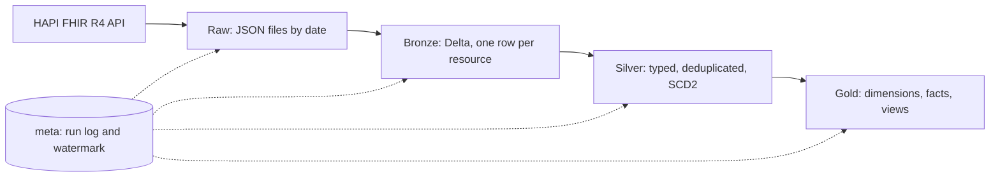

| Layer | Location | Contents |
|---|---|---|
| Raw | `/Volumes/workspace/raw/fhir/json/<resource>/load_date=YYYY-MM-DD/page_NNNN.json` | Untouched API pages plus `_manifest.jsonl` (URL, call time, save time, records per page) |
| Bronze | `workspace.bronze.<resource>` | One row per FHIR resource: full JSON string plus metadata columns |
| Silver | `workspace.silver.<resource>` | Flattened, typed, cleaned, deduplicated; SCD2 history |
| Gold | `workspace.gold.*` views | Star-schema dimensions, facts and aggregate views |
| Meta | `workspace.meta.pipeline_run_log`, `workspace.meta.watermark` | Run tracking and incremental state |

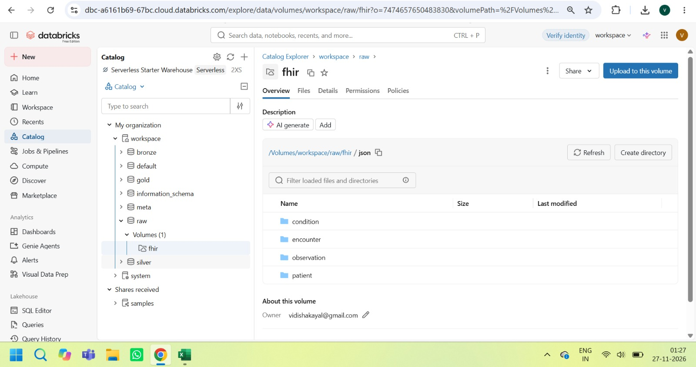
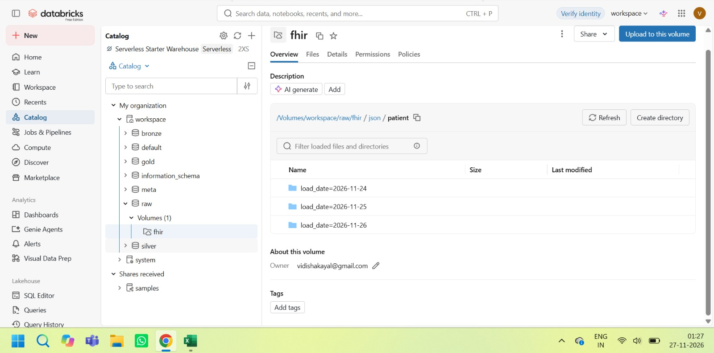

## Repository structure
```
config/config.yaml        all settings (no hardcoding)
src/                      reusable Python modules (config, API client, bronze, silver, scd2, metadata, incremental)
notebooks/                00_setup ... 09_gold_views, SCD2 demos, evidence queries
sql/gold_views.sql        Gold view definitions
pipelines/                Databricks job definition
docs/evidence/            screenshots of runs and results
```

## How to run
1. Run `notebooks/00_setup` once to create the schemas and the Raw volume.
2. Import the repo as a Databricks Git folder and attach notebooks to **Serverless** compute.
3. Run the `fhir_medallion_daily` job (Patient → Encounter → Observation → Condition → Silver → Gold), or run the notebooks manually in numeric order.
4. Settings (base URL, page size, page cap, catalog, schema and table names, first load date) live in `config/config.yaml`. Notebook widgets can override the catalog, resource and dates.

## Incremental loading
- The `_lastUpdated` filter selects one UTC day at a time, and pagination follows each Bundle's `next` link.
- `meta.watermark` stores the last fully loaded day per resource.
- Only **complete UTC days** are loaded (with a 30-minute safety lag), because an open day keeps receiving records.
- The watermark moves only after Raw, the truncation check and Bronze all succeed. A failed or truncated day stops that resource, so no gaps appear behind the watermark.
- Reruns are idempotent: a day's Raw folder and Bronze partition are replaced, and Silver skips versions it already holds.
- The `max_pages_per_run` cap (30) protects the free-tier quota. A truncated day is **not** loaded and the watermark does not advance. An early run showed why this matters: Observation for 25 Nov stopped at exactly 1,000 rows, and raising the cap gave the complete 1,138.

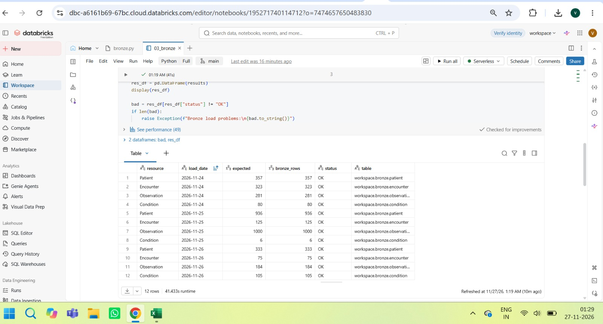
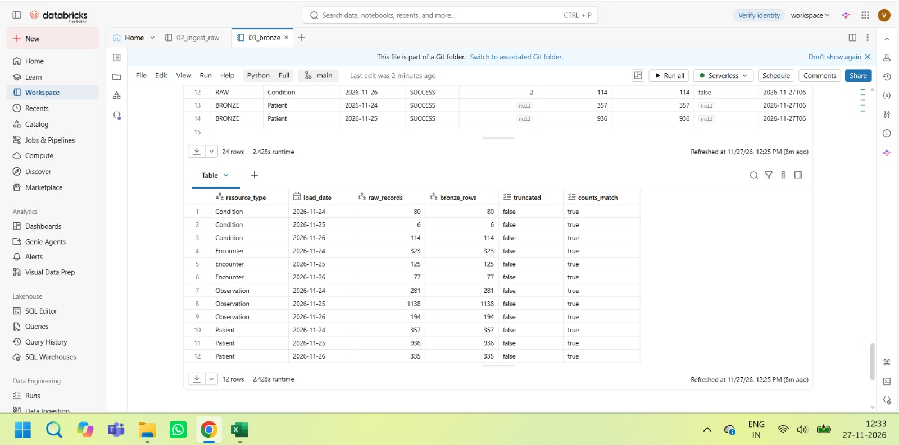
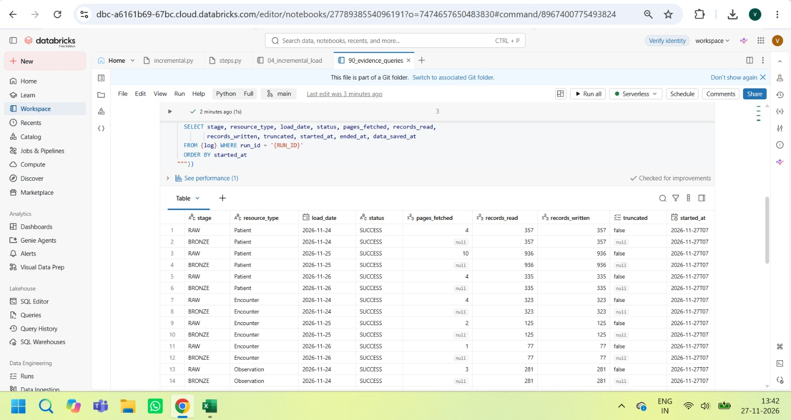
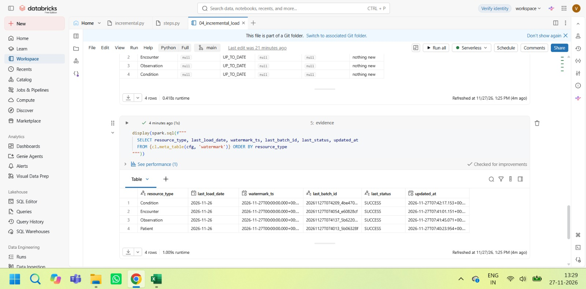
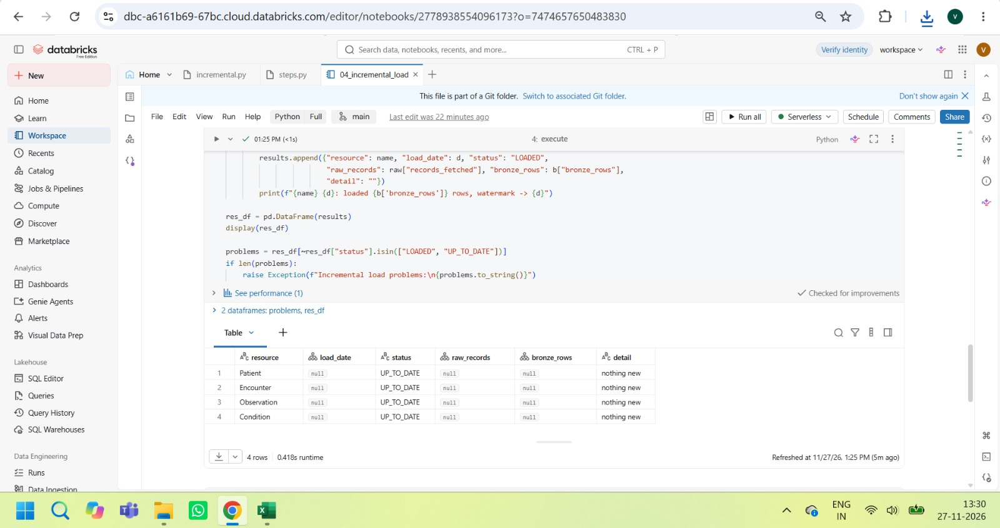

## Metadata and versioning
- **Bronze columns:** `extraction_timestamp` (when the API page was called), `api_url_or_params` (the exact URL called), `raw_saved_at`, `bronze_loaded_at` (when the data was saved), `source_file`, `page_number`, `batch_id`, `load_date`.
- **Silver and Gold** carry `extraction_timestamp`, `load_date`, `silver_processed_at` and `gold_refreshed_at` where applicable.
- **`meta.pipeline_run_log`** records every stage (RAW, BRONZE, SILVER, GOLD) per resource and date: start and end time, data-saved time, pages, records read and written, truncation flag, status and error message.

## Silver layer: cleaning
Each resource is parsed with an explicit schema (`from_json`) and flattened to typed columns:
- IDs are extracted from references (`Patient/123` → `123`).
- Dates and timestamps are parsed safely, and malformed values become `NULL`.
- Text is trimmed and blanks become `NULL`.
- `gender` is normalized to the four valid FHIR values (anything else becomes `unknown`).
- Implausible birth dates (before 1900 or in the future) become `NULL`, and an encounter end earlier than its start becomes `NULL`.
- Observation's `value[x]` variants are mapped to `value_type`, `value_number`, `value_unit` and `value_text`.
- Duplicates are removed on (resource id, version id).

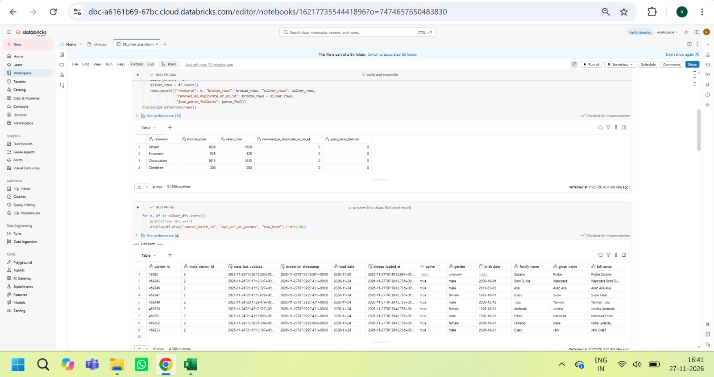
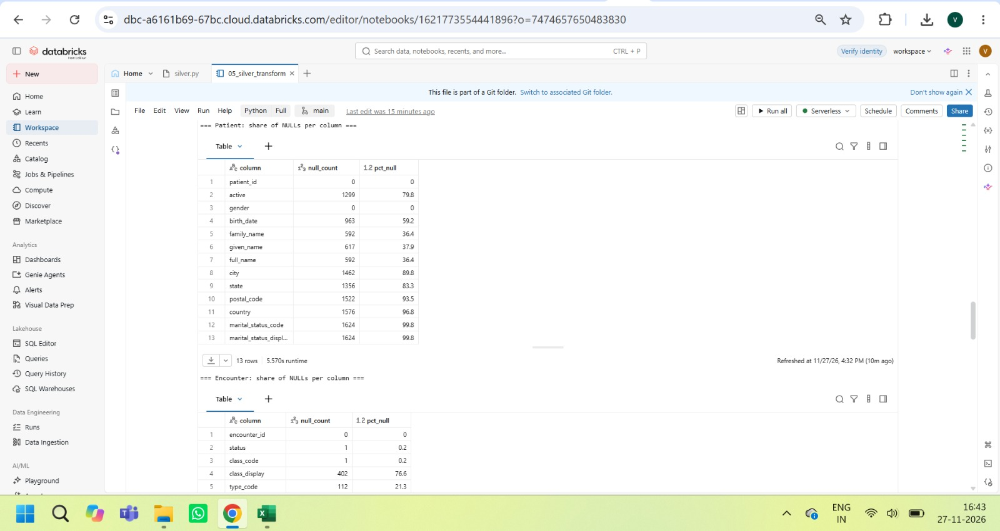
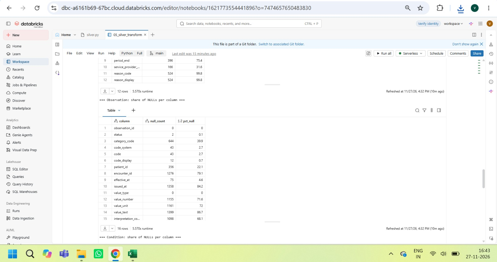
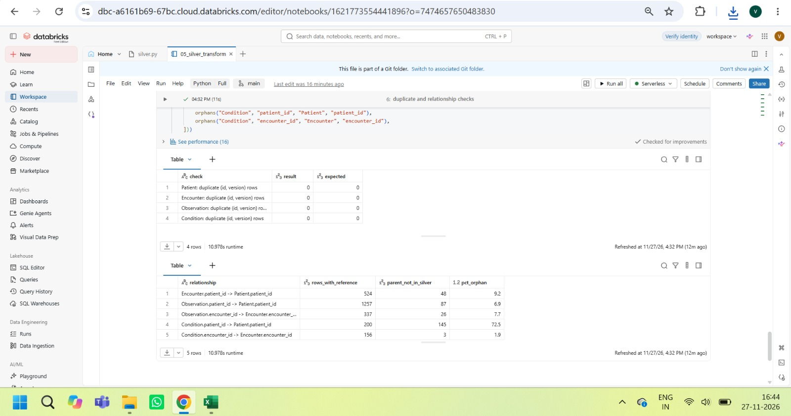

## SCD Type 2 (Silver)
Each Silver table has `effective_from`, `effective_to`, `is_current` and `version_number`.
- `effective_from` is the source's `meta.lastUpdated`, so re-fetching identical data cannot create a fake change.
- A new version is created only when `row_hash` (a hash of the business columns) differs from the previous version.
- The old row is closed (`is_current = false`, `effective_to` = the new row's `effective_from`) and the new row inserted in a single Delta `MERGE`.
- Versions already stored are skipped, which makes reruns safe. Late-arriving older versions are skipped and counted. Silver is never deleted from.
- Integrity checks (exactly one current row per id, no duplicate version numbers, no gaps or overlaps between versions) pass on all four tables.

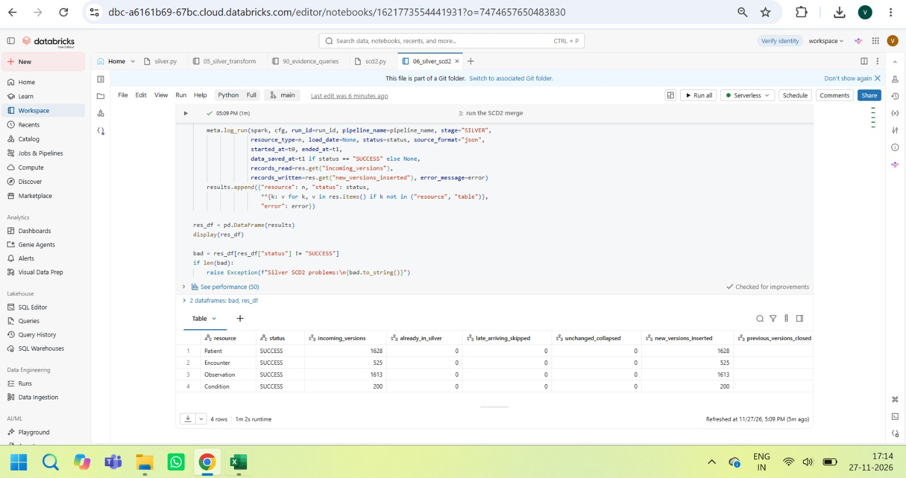
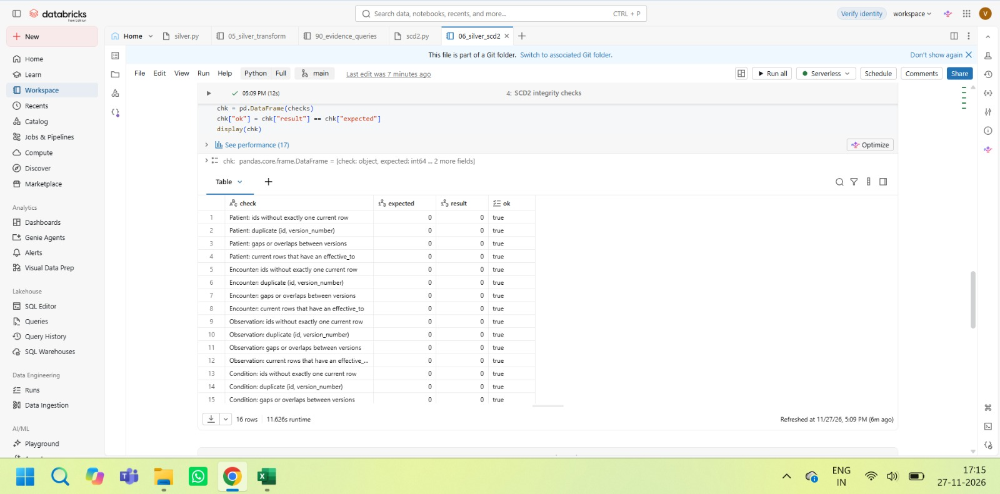
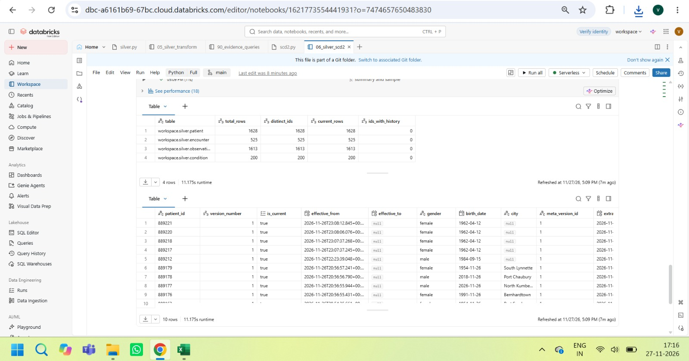
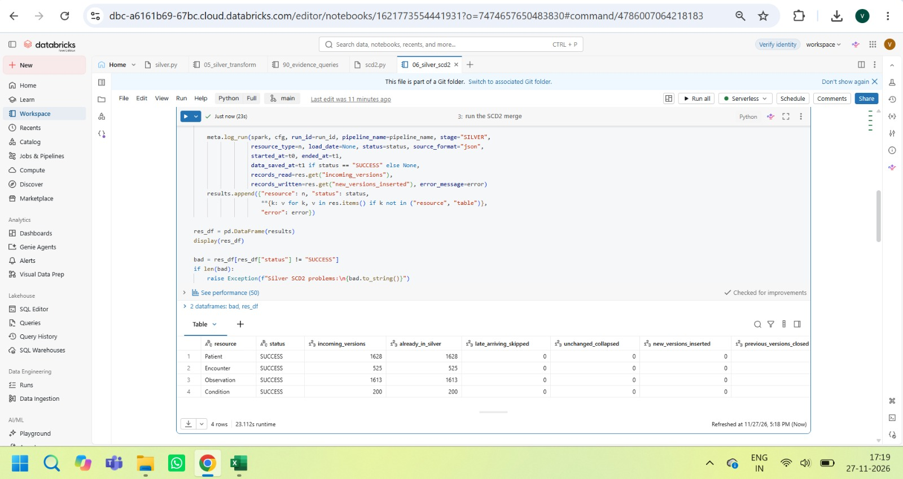

### Live proof of history
- **Controlled test:** I created two clearly labelled test patients on the public sandbox, loaded them, edited them, and loaded again.
  - *Alpha* (city Pune → Mumbai, marital status S → M) now has a closed v1 and a current v2, with v1's `effective_to` equal to v2's `effective_from`.
  - *Bravo* had only an untracked field edited. FHIR advanced its version, but Silver correctly kept a single row.
- **Natural changes:** the public sandbox occasionally edits records between loads. Two such changes (patients 883195 and 883253, edited on 27 Nov) were captured in Silver as closed v1 and current v2 rows, in addition to the controlled test patients.
- The integrity checks still pass with history present.

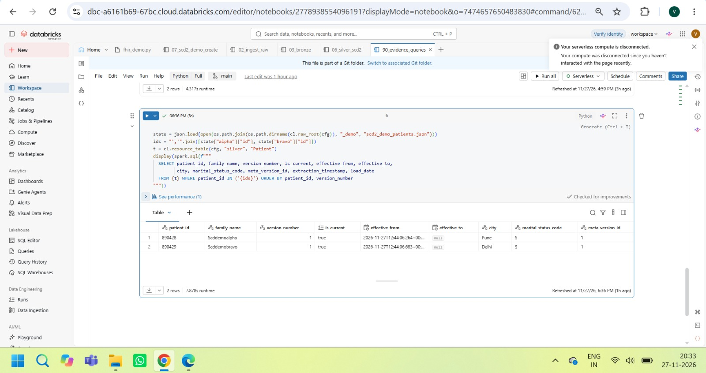
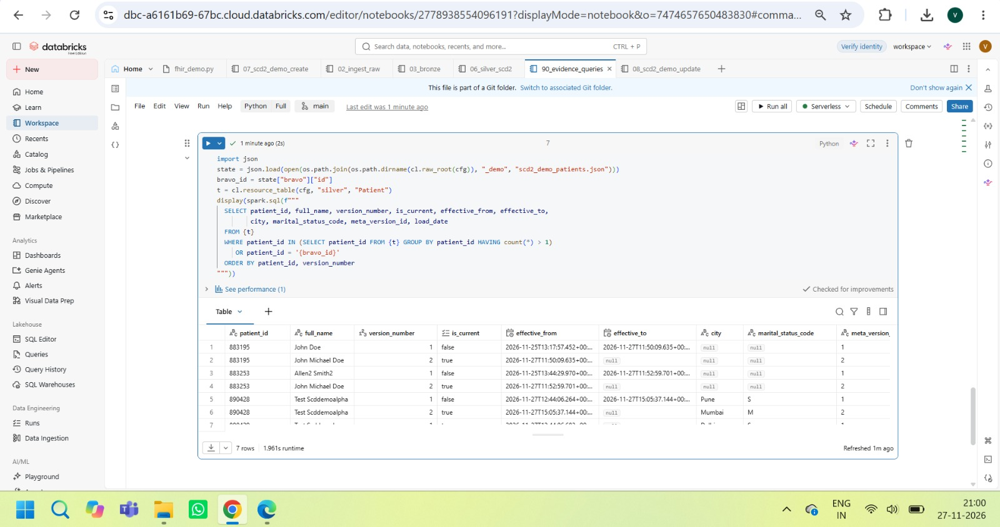
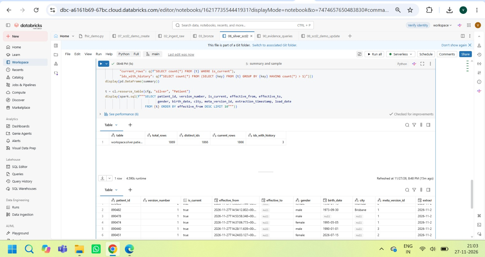

## Gold layer
Eleven views are built on the **current** rows of the Silver tables: `dim_date`, `dim_patient` (adds age and age group), `dim_patient_history`, `dim_condition`, `dim_observation_code`, `fact_encounter`, `fact_observation`, `fact_condition`, and the reporting views `vw_encounters_by_month`, `vw_top_conditions`, `vw_patient_summary`. Definitions are in `sql/gold_views.sql`, and the catalog and schema names are filled in from config.

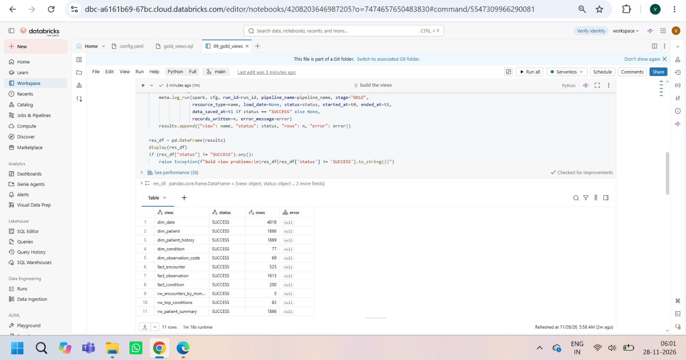
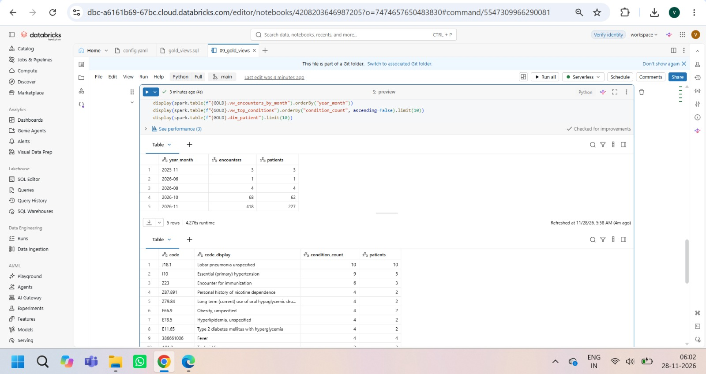

### Table dictionary
| Table | Grain | Key |
|---|---|---|
| `silver.patient` | one row per patient version | `patient_id` + `version_number` |
| `silver.encounter` | one row per encounter version | `encounter_id` + `version_number` |
| `silver.observation` | one row per observation version | `observation_id` + `version_number` |
| `silver.condition` | one row per condition version | `condition_id` + `version_number` |
| `gold.dim_patient` | current patient (adds age, age group) | `patient_id` |
| `gold.dim_patient_history` | all patient versions | `patient_id`, `version_number` |
| `gold.dim_date` | one row per calendar date | `date_key` |
| `gold.dim_condition`, `gold.dim_observation_code` | one row per code | `code_system`, `code` |
| `gold.fact_encounter`, `fact_observation`, `fact_condition` | current rows | resource id |
| `gold.vw_encounters_by_month`, `vw_top_conditions`, `vw_patient_summary` | reporting aggregates | n/a |

Silver columns (examples): Patient (`gender`, `birth_date`, `full_name`, `city`, `marital_status_code`), Encounter (`status`, `class_code`, `patient_id`, `period_start`, `period_end`), Observation (`code`, `code_display`, `patient_id`, `encounter_id`, `value_type`, `value_number`, `value_unit`, `value_text`), Condition (`clinical_status`, `code`, `patient_id`, `encounter_id`, `onset_at`).

### Table relationships
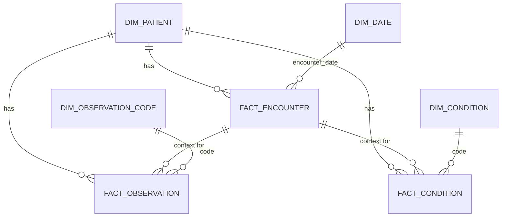
Facts use left joins, so rows whose parent is missing are kept and flagged with `patient_in_dim = false`.

## Orchestration
Databricks Workflow **`fhir_medallion_daily`** (definition in `pipelines/`):

`ingest_patient → ingest_encounter → ingest_observation → ingest_condition → silver_scd2 → gold_views`

- Each ingest task runs the Raw, Bronze, watermark and logging steps for one resource, in the required order.
- Every task receives `run_id = {{job.run_id}}` and `pipeline_name`, so all log rows from one execution share an id.
- The ingest tasks retry once, after a one-minute wait (serverless auto-optimization retries disabled). Silver and Gold tasks have no retries.
- **Schedule:** daily at 06:30 (Asia/Kolkata), which is 01:00 UTC, so the previous UTC day is always complete when the job starts.
- The notebook paths in `pipelines/fhir_medallion_daily.json` point at the author's workspace; update them after importing the repo elsewhere.

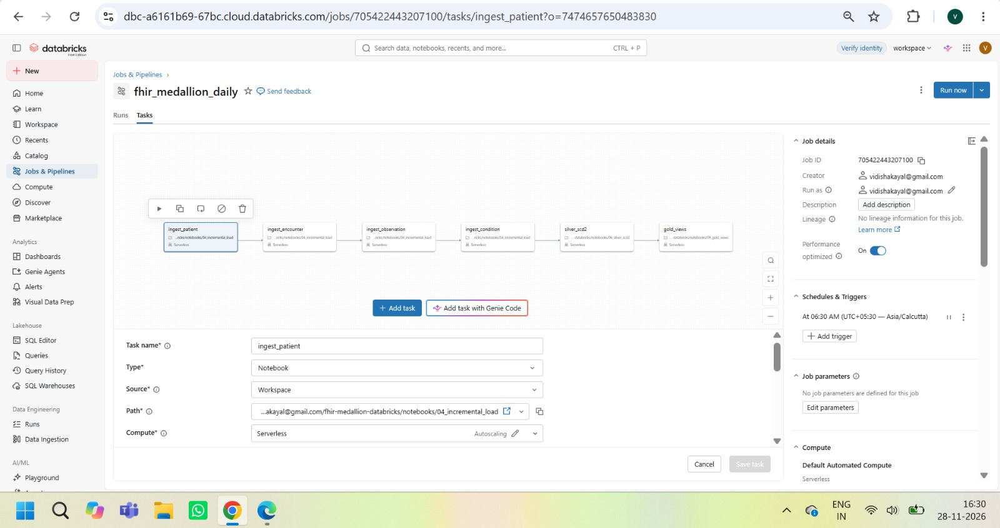
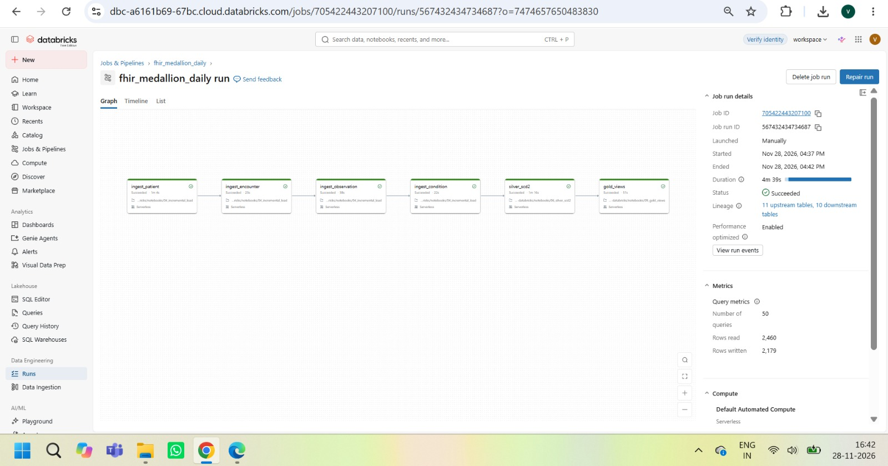

## Results (loads for 24 to 27 Nov 2026)
24, 25 and 26 Nov were loaded as a backfill; 27 Nov was loaded by running the `fhir_medallion_daily` workflow (Run now) once that UTC day had completed. The same job is scheduled to run daily at 06:30 IST.

| Resource | Bronze rows | Silver rows (all versions) | Silver current | Gold rows |
|---|---|---|---|---|
| Patient | 1926 | 1928 | 1924 | 1924 |
| Encounter | 549 | 549 | 549 | 549 |
| Observation | 3460 | 3459 | 3459 | 3459 |
| Condition | 232 | 232 | 232 | 232 |

Raw and Bronze counts reconcile exactly through the run log. Silver can differ slightly from Bronze: Bronze day-partitions are replaced on reruns, while Silver keeps every version it has seen, and versions that change nothing we track are collapsed. Gold equals Silver current rows.

The single Observation present in Bronze but not in Silver (3460 vs 3459) is `886361`. It was edited on 27 Nov, giving it FHIR version 2, but none of the columns tracked in Silver changed, so v1 and v2 have an identical `row_hash` and Silver correctly created no new version. Every other Bronze version is present in Silver.

The 27 Nov workflow run started only after that UTC day had completed. An earlier partial load of the same day (while it was still open) was superseded by the complete one, and Silver inserted only the versions it did not already hold.

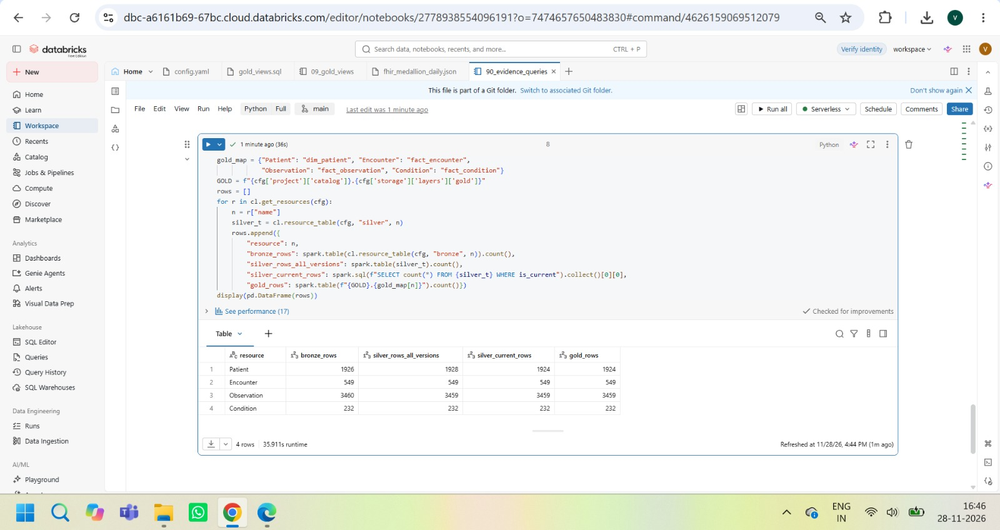
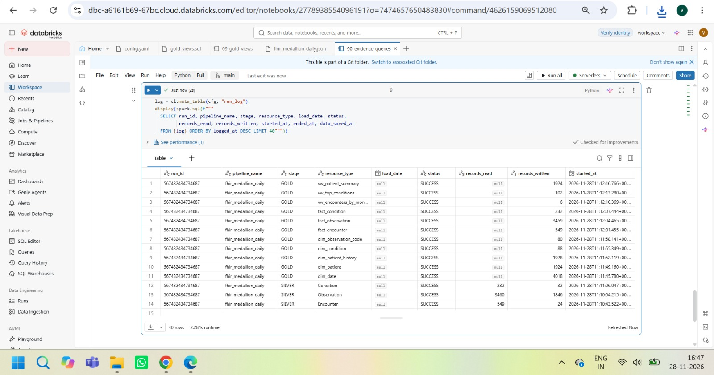
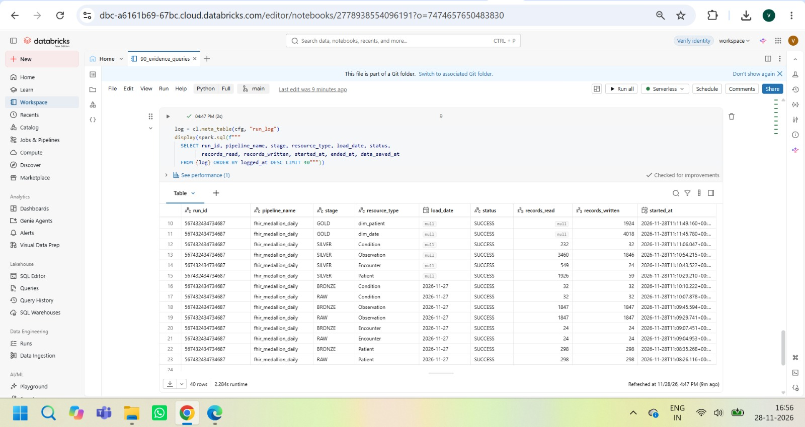

## Data quality and known limitations
- **Orphan references:** each load covers a date window, so some child records point at parents last updated on another day (for example 72.5% of Conditions → Patient in the initial three-day load). Gold keeps these rows via left joins.
- **22% of Observations (356 of 1,613 in the initial load)** have no `subject` in the source and keep `patient_id = NULL`.
- Public sandbox data is sparse (for example about 60% of patients have no birth date).
- Only the first name, address and coding of each array is flattened. Observation components are counted, not flattened.
- Only columns selected in Silver are compared for SCD2 changes. Source-side deletions are not tracked.
- The server's `_lastUpdated` matches only a resource's current version, so history appears only when a record changes between loads. SCD2 is demonstrated with the controlled test patients and the natural sandbox edits described above.
- The live SCD2 demo used two loads of the same UTC day; the daily incremental behavior is shown by the 24 to 27 Nov loads.
- Free Edition: serverless compute only, with a daily quota.
